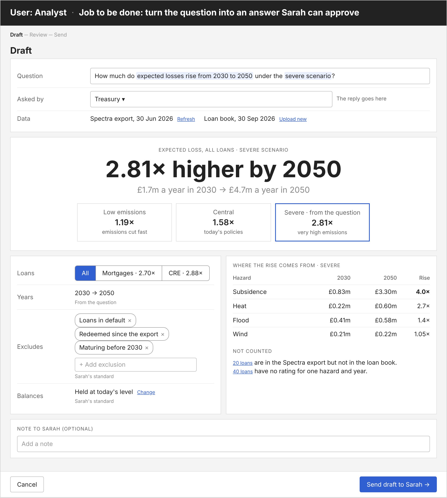

# Run 1: solution design

A report builder with Sarah's defaults, a method note it writes itself, her approval and a drafted reply. No AI in this version. Medium fidelity; numbers from the practice data and synthetic loan book. Source: `design/solution-design.html`.

## Walkthrough
- **Analyst:** I've just received an email from the credit committee: "How many CRE loans have a flood rating of E or worse by 2050?" I paste it in and pick who asked. The scenario, year and exclusions are already set to Sarah's standard, and the answer is there: 3 loans, £5.4m. I check the loans behind it, try severe to see if it matters, add a note and send the draft to Sarah
- **Sarah:** a draft is waiting. I read the question and the answer, glance at the loans and the method, and approve. If something's off, I change it or send it back with a comment
- **Analyst:** it's approved. The reply and the file are drafted; I read it and send

## Flow
| Step | Who | Screen | Ends in |
|---|---|---|---|
| 1 | Analyst | Draft | Send draft to Sarah |
| 2 | Sarah | Review the draft | Approve, or send back |
| 3 | Analyst | Send the answer | Send |

Askers (CRO, committees, pricing, treasury, IR) never touch it: they email the question and get the reply.

## 1. Draft

- **Removes:** choosing scenario, horizon and loans by hand, the write-up, and "what about severe?" restarting it
- **Inputs:** question, asked by and data (required). Scenario, year and leave-out start on Sarah's standard for that asker; the year follows the question. Note to Sarah is optional
- **Checks:** year differs from the question, or the data is stale → shown here, so the analyst fixes it before Sarah sees it. Loss to the bank → refused, with why
- **Ends in:** Send draft to Sarah. The number updates live as the toggles change

## 2. Review the draft

- **Removes:** half a day of checking someone else's numbers
- **Inputs:** scenario, year and leave-out can be changed; a comment is required to send back
- **Ends in:** Approve, or Send back to the analyst with the comment. Nothing goes out without her approval

## 3. Send the answer

- **Removes:** writing the reply and building the Excel by hand
- **Inputs:** the drafted reply, editable
- **Ends in:** Send. Logged with who asked, built and approved, the data dates and the version

## Test set
| Case | Expected |
|---|---|
| Credit committee: CRE, flood E or worse, 2050, central | 3 of 144 loans, £5.4m of £351.8m · severe 5 loans, £9.6m |
| CRO: total by 2050, by hazard and region | £3.31m central, £6.10m severe · subsidence and South East top under both |
| Mortgage pricing: 2024–25 lending, subsidence E to G | £52.3m, 24.3% of new lending vs 8.6% older · origination-source check flagged |
| Treasury: rise 2030 → 2050, severe | 2.74× (1.57× central) |
| Sent-back draft rebuilt (2030, redeemed loans included) | Analyst warned on Draft before sending: wrong year, stale data · 4 of 145, £6.2m vs 3 of 144, £5.4m when fixed |
| "Loss to the bank" | Refused with the reason |

The CRO, pricing and treasury figures are from the Spectra file alone; recompute them with the default exclusions when the prototype is rebuilt.

## Not yet tested
- Main flow walked once as the analyst and as Sarah. Next: the Draft screen with a handful of edge cases (no year in the question, a hazard not in the data, zero loans), then with Sarah and an analyst
