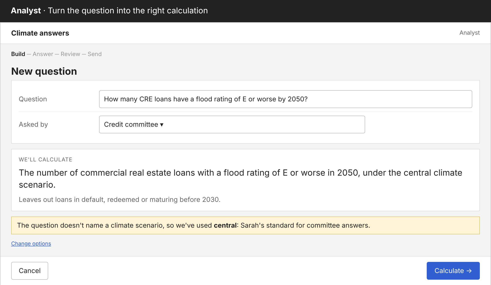
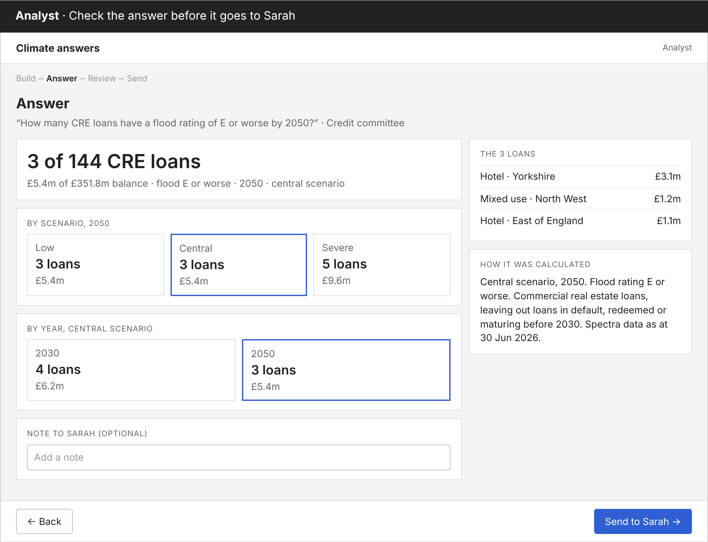
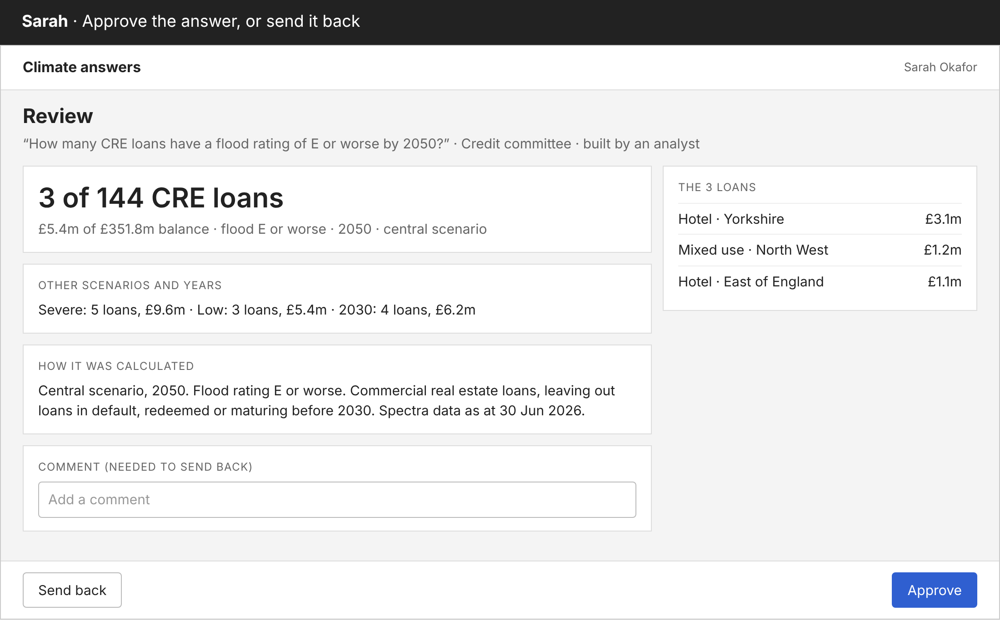
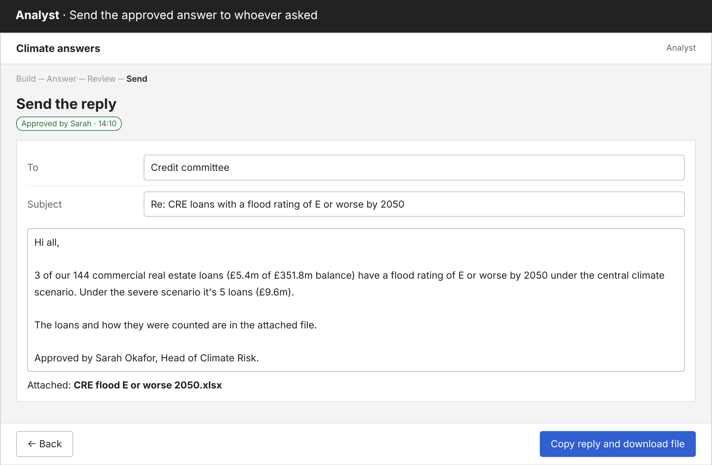

# Run 1: solution design

A report builder with Sarah's defaults, a method note it writes itself, her approval and a drafted reply. No AI in this version. Medium fidelity; numbers from the practice data and synthetic loan book. Source: `design/solution-design.html`.

## Flow
| Step | Who | Screen | Ends in |
|---|---|---|---|
| 1 | Analyst | New question | Calculate |
| 2 | Analyst | Answer | Send to Sarah |
| 3 | Sarah | Review | Approve, or send back |
| 4 | Analyst | Send the reply | Reply copied and file downloaded, logged |

Askers (CRO, committees, pricing, treasury, IR) never touch it: they email the question and get the reply.

**Decisions to agree**
1. Question and options on one screen: **recommend yes**
2. No AI in this version: **yes** (agreed in the concept)
3. Fast-track review: a follow-up with one changed option and all checks passing shows Sarah only the change: **recommend yes**, confirm with her
4. The product drafts the reply; the analyst sends it from their own email: **recommend yes**

## 1. New question

- **For:** analyst, to turn the question into the right calculation
- **Inputs:** the question and who asked (required). Who asked sets Sarah's defaults: for committees, central scenario, 2050, leaving out loans in default, redeemed or maturing before 2030
- **Shows:** one sentence of what will be calculated, and only what needs attention. Everything else is under "Change options"
- **Checks:** no scenario in the question → **notes** the default used. Year picked differs from the question → **warns** "The question says 2050; you picked 2030". Departing from Sarah's defaults → reason required. Loss to the bank → **refused**, with why

## 2. Answer

- **For:** analyst, to check the answer before it goes to Sarah
- **Shows:** the answer, the same count by scenario and by year, the loans, and how it was calculated
- **Checks:** shown here only when one fails, so the analyst fixes it before Sarah sees it (e.g. stale data: "Loans redeemed since the export are included")
- **Inputs:** a note to Sarah (optional)

## 3. Review

- **For:** Sarah, to approve the answer or send it back
- **Shows:** what the analyst sent: the answer, other scenarios and years, how it was calculated, the loans, and their note if any
- **Inputs:** approve, or send back with a comment (required to send back)

## 4. Send the reply

- **For:** analyst, to send the approved answer to whoever asked
- **Shows:** a drafted reply and the Excel file with the loans and the method
- **Ends in:** copy the reply and download the file; logged with who asked, built and approved

## Test set
| Case | Expected |
|---|---|
| Credit committee: CRE, flood E or worse, 2050, central | 3 of 144 loans, £5.4m of £351.8m · severe 5 loans, £9.6m |
| CRO: total by 2050, by hazard and region | £3.31m central, £6.10m severe · subsidence and South East top under both |
| Mortgage pricing: 2024–25 lending, subsidence E to G | £52.3m, 24.3% of new lending vs 8.6% older · origination-source check flagged |
| Treasury: rise 2030 → 2050, severe | 2.74× (1.57× central) |
| Sent-back draft rebuilt | 2 failed checks · 4 of 145, £6.2m vs fixed 3 of 144, £5.4m |
| "Loss to the bank" | Refused with the reason |

The CRO, pricing and treasury figures are from the Spectra file alone; recompute them with the default exclusions when the prototype is rebuilt.

## Limits shown in the product
- Damage to properties, not loss to the bank
- Practice data and a synthetic loan book until procurement signs
- Central = SSP2-4.5, severe = SSP5-8.5 (to confirm with Sarah)
