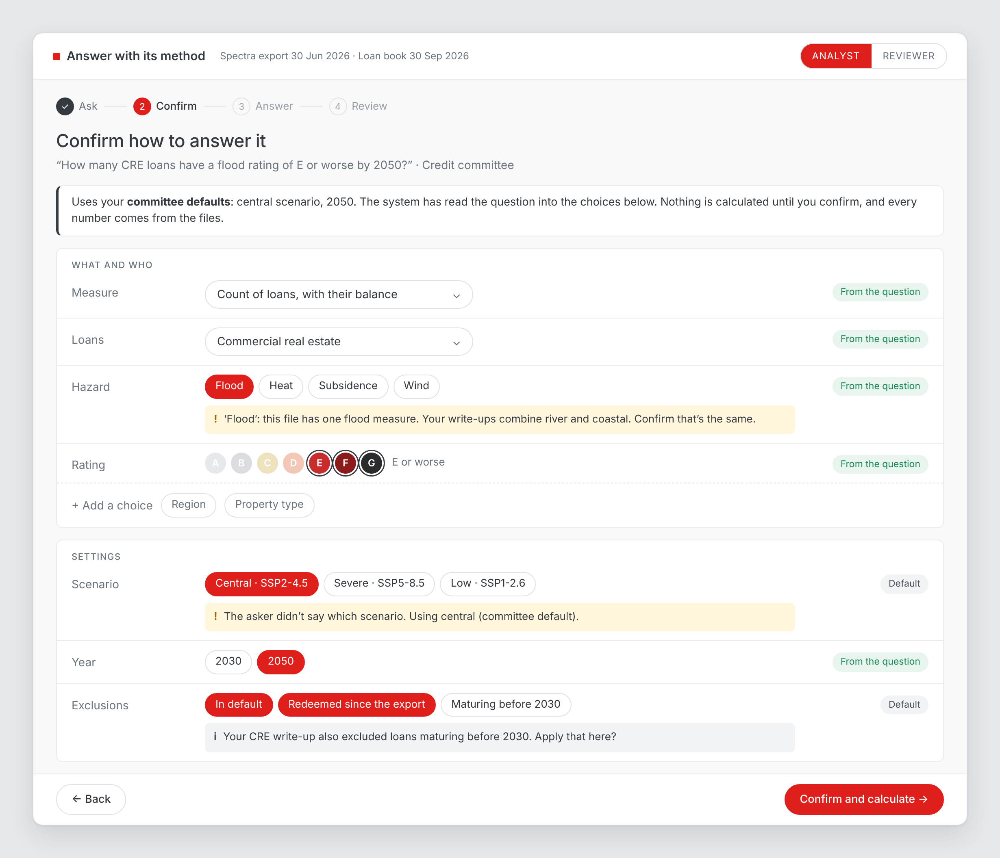
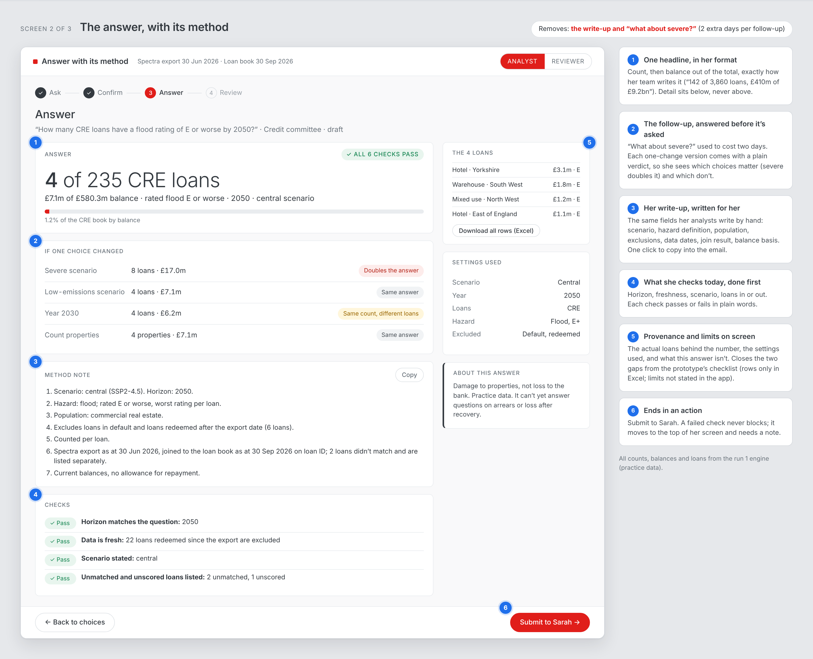
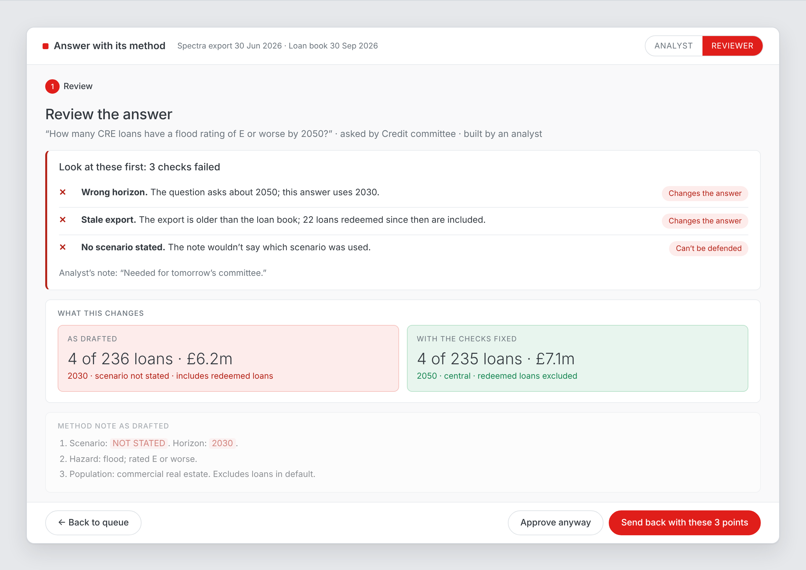

# Run 1: visual design

From `solution-detail.md`. Status: **agreed**. Next: `clickable-prototype.md`.

Source `design/visual-design.html`, rendered to `design/screen-1.png` to `screen-3.png`. Every count, balance and loan comes from the run 1 engine on the practice data.

| | Screen | Why it looks like this |
|---|---|---|
| 1 |  **Confirm how to answer it** | One line on the defaults in use. Each choice tagged by where it came from; the unstated scenario flagged, not silently filled; a suggestion from her own write-ups; "+ Add a choice" for what the AI missed |
| 2 |  **The answer, with its method** | One headline in her format. One-change versions with plain verdicts, so "what about severe?" is already answered. Method note in her fields with Copy. The 4 loans on screen; "About this answer" states the limits |
| 3 |  **Sarah's review: a draft with three slips** | Failed checks first, each in plain words with its effect. As drafted vs with the checks fixed, side by side. Send back pre-filled; approve still possible and logged |

## Brand
Climate X palette and type from climate-x.com's CSS (see `climate-x-company` → Brand): Graphik, with Inter standing in; red `#e01e1a`, charcoal `#343a40`, off-white `#f9f9fa`. Conventions from Spectra and Carta screenshots: white panels, A–G rating circles, pill buttons. Failures carry a label and an icon, never colour alone, since brand red is also the failure colour.
